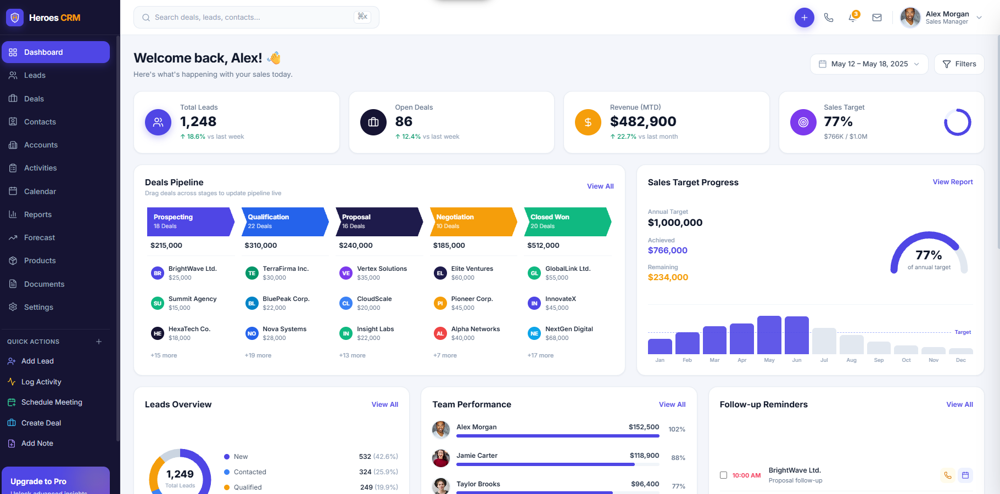

# Heroes CRM Dashboard

Template frontend CRM responsif untuk menampilkan pipeline penjualan, leads, kontak, aktivitas, kalender, laporan, dan forecast. Demo bisa dibuka tanpa akun atau backend.

**[Buka demo di GitHub Pages](https://laluarifta.github.io/heroes_crm_dashboard-/)**

## Preview



## Yang bisa dicoba

- Pindahkan deal antar tahap melalui pipeline atau tampilan Kanban.
- Buat dan kelola lead, kontak, akun, aktivitas, dan jadwal.
- Cari data dengan `Ctrl+K` / `Cmd+K`. Lihat laporan, ekspor CSV, atau simpan cadangan JSON.
- Ganti tema atau kembalikan data contoh melalui **Settings**.

Demo menggunakan data fiktif. Perubahan disimpan di `localStorage` browser masing-masing, bukan di server atau dibagikan ke pengunjung lain. Email, panggilan, dan penagihan hanya simulasi. Jangan gunakan demo publik untuk data pelanggan sungguhan. Foto contoh dimuat dari Unsplash.

## Menjalankan secara lokal

Gunakan Node.js 24 LTS dan npm. Klik **Use this template** di GitHub untuk membuat repo baru, lalu clone repo tersebut.

```bash
npm ci
npm run dev
```

Buka alamat lokal yang ditampilkan Vite. Untuk menguji hasil build produksi:

```bash
npm run build
npm run preview
```

## Struktur proyek

```text
.
├── .github/workflows/pages.yml   # Build dan deploy otomatis ke GitHub Pages
├── docs/assets/                  # Gambar preview README
├── public/
│   ├── favicon.svg
│   └── scripts/
│       ├── app.js                # Navigasi, penyimpanan, dan pengelolaan data
│       ├── dashboard.js          # KPI, grafik, dan pipeline
│       └── demo-data.js          # Data awal yang bisa diganti
├── src/
│   ├── main.js                   # Entry Vite, ikon Lucide, dan font Inter
│   └── styles.css                # Token warna serta gaya dashboard
└── index.html                    # Kerangka antarmuka CRM
```

## Menerbitkan salinan sendiri

Di repo baru, pilih **Settings → Pages → Source → GitHub Actions**. Jalankan workflow **Deploy GitHub Pages** dari tab **Actions**, atau push ke branch `main`. Workflow menerbitkan folder `dist/`; URL demo muncul di **Settings → Pages** setelah deployment berhasil. Perbarui tautan demo di README agar mengarah ke repo baru.
